# Dane Babcock · AI Engineer

I build LLM-powered apps, agent skills, and workflow automations. My background in web and API penetration testing shapes how I build and evaluate them.

[](https://github.com/DaneB1914/reportops-ai)

## Featured projects

### 01 · ReportOps AI

A Python tool that takes structured vulnerability findings and drafts pentest reports with reproduction steps, impact, and remediation.

[View the repository](https://github.com/DaneB1914/reportops-ai)

<details>
<summary><strong>See an example finding</strong></summary>

**Sample input** from the project README

```json
[
  {
    "title": "Cross-Site Scripting (XSS)",
    "endpoint": "/search",
    "method": "GET",
    "description": "Reflected XSS in search parameter"
  }
]
```

**Illustrative draft** using a fictional target

| Section | Draft |
| --- | --- |
| Finding | Reflected cross-site scripting in `GET /search`. |
| Reproduction | On the test instance, submit a harmless JavaScript proof of concept through the search parameter and check whether it executes in the browser. |
| Impact | A crafted search link could run script in the context of the application when a user opens it. |
| Remediation | Apply context-appropriate output encoding when displaying the search term. Retest the affected response after the fix. |

</details>

### 02 · AI Engineering Reviewer

An open-source skill for Codex and Claude Code that traces relevant code paths and separates verified defects from risks that need testing.

[View the skill](https://github.com/DaneB1914/ai-engineering-reviewer)

### 03 · ChoiceLens

A Gemini-powered web app for comparing options, adjusting criteria weights, and exploring trade-offs. Built in Google AI Studio.

[View the repository](https://github.com/DaneB1914/ChoiceLense) · [Try the beta demo](https://choicelens-decisions.ai.studio/)

## What I’m working on

I’m getting deeper into prompt evaluation, structured outputs, and ways to make agent behavior easier to verify. I’m interested in remote AI engineering and automation roles.

**Tools I use** · Python, TypeScript, React, Gemini, Codex, and Claude Code  
**Credential** · Google AI Professional Certificate

[Browse my GitHub repositories](https://github.com/DaneB1914?tab=repositories)
